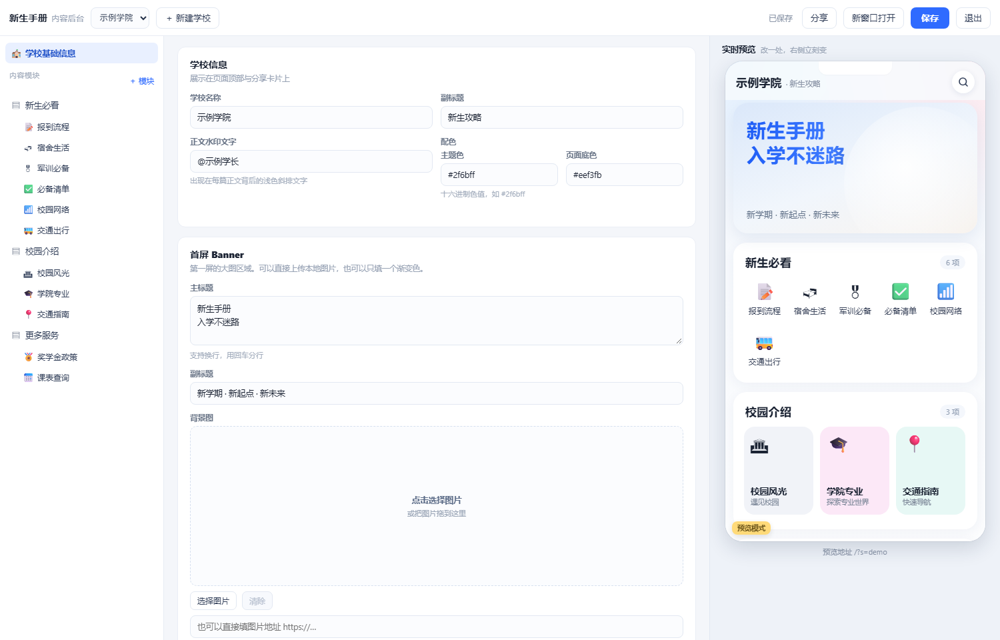

# 校园新生手册 · 前后端分离模板

一套可复用的「新生手册」系统：**前台 H5 展示 + 后台内容管理 + 实时预览**。照着它，把内容换成另一所学校的就能上线。

- 前台：`http://localhost:5173/?s=cqtbu`（手机端视图，桌面自动居中）
- 后台：`http://localhost:5173/admin/`（**仅本机可访问**；密码用 `node server/setpass.js` 设置）
- 零第三方依赖：只用 Node 内置模块，`node server/server.js` 即可跑

| 前台（手机视图） | 后台（表单 + 实时预览） |
|---|---|
|  |  |

---

## 一、跑起来

```bash
cd 新生手册
node server/server.js
# 打开 http://localhost:5173/
```

也可以用 `npm start`（等价于 `node server/server.js`，无依赖、无需 `npm install`）。

默认端口 5173，可用环境变量改：`PORT=8080 node server/server.js`。

> 需要 Node 18+（自带 `node:` 前缀模块与 `fetch`）。本项目在 Node 22 下验证通过。

### 第一次启动先设密码

后台没有默认密码，第一次用要先设一个（只存 scrypt 哈希，不存明文）：

> 仓库里的 `db.json` 已经把密码哈希清空了（避免把密码哈希推到公开仓库），所以 clone 下来必须先执行下面第一条命令，否则后台登录会一直返回「账号或密码错误」；启动日志也会提示「还没有设置管理密码」。密码只写进 `server/data/admin.local.json`（已被 `.gitignore` 忽略），不会进版本库。

```bash
node server/setpass.js              # 随机生成 16 位强密码并打印，只显示一次
node server/setpass.js 你的密码      # 指定密码（至少 8 位）
node server/setpass.js 新密码 用户名  # 指定账号，默认 admin
```

改完密码请重启服务，旧会话随之失效。

---

## 二、目录结构

```
新生手册/                  # 仓库根目录即项目根目录
├── server/
│   ├── server.js          # 全部后端：静态托管 + REST API + 会话 + 正文遮蔽 + 后台访问边界
│   ├── setpass.js         # 设置后台密码（scrypt 哈希写入 admin.local.json，不入库），无参数则随机生成
│   ├── export-static.js   # 导出纯静态站到 dist/（给 GitHub Pages 用）
│   ├── lib/public.js      # 对外公开视图（在线服务与静态导出共用同一份逻辑）
│   └── data/db.json       # 数据文件（学校 / 模块 / 条目 / 正文）；仓库中不含密码哈希
├── web/                   # 前台（消费端）
│   ├── index.html
│   ├── style.css
│   └── app.js             # 渲染首页、弹层正文、密码墙、搜索、预览模式
├── admin/                 # 后台（编辑端）
│   ├── index.html
│   ├── admin.css
│   └── admin.js           # 树形结构 + 表单 + 实时预览（postMessage）
├── uploads/               # 后台上传的图片（自动创建，文件名带随机串）
├── .github/workflows/
│   └── pages.yml          # push 到 main 自动导出并发布到 GitHub Pages
└── docs/
    ├── STRUCTURE.md       # 原产品拆解与数据模型对照
    └── screenshots/       # README 用的界面截图
```

前后端是**真正分离**的：前台只通过 HTTP 调 `/api/*`，不依赖后端模板；后端只输出 JSON 与静态文件。
把 `web/` 换成 Vue/React 工程、或部署到 CDN，后端一行都不用改。

---

## 三、后台怎么用（核心流程）

1. 用**这台电脑**的浏览器打开 `/admin/`，输入管理密码登录（其他设备打开只会看到 403，见第十节）；
2. 左栏是结构树：**学校基础信息 → 内容模块 → 模块下的条目**；
3. 点任一节点，中间出表单，**右侧手机框实时跟着变**；
4. 编辑条目时，右侧会自动**打开这个条目的正文弹层** —— 改一行字，弹层立刻更新；
5. 改完点右上「保存」，前台 `/` 立即生效。

支持的编辑动作：

- 学校：名称、副标题、水印、主题色、Banner（标题/副标题/**背景图上传**/图片用法/文字颜色/遮罩浓度/底色）、页脚（版权 / 按钮文字 / 点击行为）、**联系学长名片**（称呼、微信号、二维码、提示语）
- 模块：标题、**三种布局切换**（图标网格 / 横滑卡片 / 双列列表）、计数文案、显隐、排序、删除
- 条目：标题、副标题、emoji 图标、类型（图文 / 外链）、排序、删除
- 正文：8 种内容块的增删改排序（段落 / 小标题 / 表格 / 提示块 / 列表 / 步骤 / 图片 / 链接）
- 密码墙：开关、免费比例（%）、访问密码、联系方式
- 顶部「＋ 新建学校」：**可以勾选「复制当前学校内容作为模板」**，一键派生一所新学校

### 图片怎么放

所有图片位（首屏 Banner 背景、正文里的「图片」块、页脚名片的微信二维码）都是同一个控件，三种放法任选：

| 方式 | 操作 |
|---|---|
| 点选上传 | 点虚线框 → 选本地文件，自动上传并回填地址 |
| 拖入上传 | 把图片文件直接拖进虚线框 |
| 贴外链 | 在下方输入框粘 `https://…` 地址 |

限制与行为：

- 支持 **JPG / PNG / WebP / GIF**，单张 ≤ **8MB**；后端按文件头（magic bytes）校验，改扩展名骗不过去；
- 上传后落在 `uploads/`，返回 `/uploads/<随机名>.<ext>`，前端直接引用，**点保存后前台立即生效**；
- 文件名随机且带长缓存（响应头 `immutable`），换图不会读到旧缓存；
- Banner 有两种用图方式：**整幅铺满**（文字压在图上，用「遮罩浓度 + 文字颜色」调可读性）与**右侧半幅切图**（贴近原产品观感）；不填图时退回渐变色。

---

## 四、数据模型

```jsonc
{
  "schools": {
    "cqtbu": {
      "slug": "cqtbu",
      "name": "重庆工商职业学院",
      "subtitle": "连接世界 · 从这里开始",
      "watermark": "新生手册",
      "theme": { "primary": "#2f6bff", "bg": "#eef3fb" },
      "banner": {
        "title": "关注学长\n新生不迷路",
        "subtitle": "新学期 · 新起点 · 新未来",
        "image": "/uploads/xxxx.png", // 上传地址或外链；空则用 tint 渐变
        "fit": "cover",               // cover=整幅铺满 | side=右侧半幅切图
        "overlay": 58,                // 遮罩浓度 0-100，仅 cover 生效
        "textTone": "dark",           // dark=深色文字(浅遮罩) | light=白字(深遮罩)
        "tint": "#dfeaf7"
      },
      "footer": {
        "copyright": "© 2026 校园新生手册 版权所有",
        "ctaText": "联系学长",        // 按钮文字；留空则不显示
        "ctaMode": "contact",         // contact=弹出联系名片 | link=跳转 ctaUrl
        "ctaUrl": "",
        "contact": {                  // 名片内容（ctaMode=contact 时生效）
          "name": "荣~荣学长",         // 二维码上方的称呼，可留空
          "wechatId": "wxid_xxx",     // 微信号，前台可一键复制
          "qr": "/uploads/xxxx.png",  // 二维码图片；与 wechatId 都空则显示「稍后再来」
          "tip": "长按识别二维码，或复制微信号添加"
        }
      },
      "sections": [
        {
          "id": "sec_newbie",
          "title": "新生必看",
          "layout": "grid",          // grid | cards | list
          "countText": "",           // 空则自动 "N 项"
          "visible": true,
          "entries": [
            {
              "id": "e_report",
              "title": "报道流程",
              "subtitle": "",
              "icon": "🗓️",
              "type": "article",     // article | link
              "url": "",
              "lock": { "enabled": true, "freeRatio": 0.2, "password": "1234", "contact": "微信：demo-wechat" },
              "blocks": [
                { "type": "p", "text": "支持 **加粗**" },
                { "type": "h2", "icon": "🕐", "text": "报到时间与地点" },
                { "type": "table", "head": ["项目", "详细信息"], "rows": [["报到时间", "9 月 5-6 日"]] },
                { "type": "callout", "tone": "warn", "text": "橙色提示" },
                { "type": "steps", "items": [{ "t": "第一步", "d": "说明" }] }
              ]
            }
          ]
        }
      ]
    }
  }
}
```

---

## 五、API

| 方法 | 路径 | 说明 | 鉴权 |
|---|---|---|---|
| GET | `/api/schools` | 学校列表 | 否 |
| GET | `/api/school/:slug` | 前台用学校数据（**不含正文**） | 否 |
| GET | `/api/entry/:slug/:id` | 正文预览（超比例自动截断） | 否 |
| POST | `/api/entry/:slug/:id/unlock` | `{password}` 校验后返回全文 | 否 |
| POST | `/api/admin/login` | `{user,pass}` → `{token,ttl}`；连错 5 次返回 429 | 否 |
| GET | `/api/admin/me` | 校验当前 token 是否有效 | Bearer |
| POST | `/api/admin/logout` | 使当前 token 立即失效 | Bearer |
| GET | `/api/net` | 本机可用访问地址（分享面板用） | Bearer |
| GET | `/api/admin/school/:slug` | 读整校（含全部正文） | Bearer |
| PUT | `/api/admin/school/:slug` | 保存整校 | Bearer |
| POST | `/api/admin/schools` | 新建学校 `{slug,name,copyFrom}` | Bearer |
| POST | `/api/admin/upload` | 请求体直接是图片二进制，`content-type` 为图片类型 → `{url}` | Bearer |
| GET | `/uploads/<file>` | 已上传图片（长缓存） | 否 |

上传示例：

```bash
TOKEN=$(curl -s -X POST -H 'content-type: application/json' \
  -d '{"user":"admin","pass":"你的密码"}' http://localhost:5173/api/admin/login \
  | node -pe 'JSON.parse(require("fs").readFileSync(0)).token')

curl -X POST -H "content-type: image/png" -H "authorization: Bearer $TOKEN" \
  --data-binary @banner.png http://localhost:5173/api/admin/upload
# → {"ok":true,"url":"/uploads/mw5p5qb6_xxx.png","size":487101,"mime":"image/png"}
```

**密码墙在服务端实现**：`GET /api/entry/...` 按 `freeRatio` 按字数截断后再返回，未解锁的访客在浏览器里翻不到剩余正文。

---

## 六、做「你自己学校」的三条路

**A. 后台里派生（最快）**
`＋ 新建学校` → 填名称和 slug → 勾"复制当前学校内容" → 逐条改文案、换图标 → 保存。
访问 `/?s=你的slug` 即可。

**B. 直接改种子数据**
编辑 `server/data/db.json`，`slug` 换掉、`sections` 换成你校的板块。适合一次性导入。

**C. 批量导入**
把学校的通知/手册整理成 CSV 或 Markdown，写个脚本映射成上面的 JSON 塞进 `db.json`。正文块的粒度足够细，能保住原有排版。

---

## 七、上线前要补的四件事

| 项 | 现状 | 建议 |
|---|---|---|
| 存储 | JSON 文件，全量读写 | 换 SQLite（`better-sqlite3`）或 PostgreSQL，加乐观锁 |
| 鉴权 | scrypt 哈希 + 内存 session（重启即失效）+ 登录限速 | 单机够用；要多实例部署时换 JWT/Redis 存会话，账号从 `db.json` 移到 `users` 表 |
| 图片 | 已支持本地上传到 `uploads/` | 文件多了会占磁盘、也不利于多机部署；建议换对象存储 / CDN，只改 `handleUpload()` 的落盘方式 |
| 多租户 | 靠 `?s=slug` | 若要每校独立域名，在反代层按 Host 注入 slug，或前端读 `location.host` |

---

## 八、已验证

- 前台首屏渲染与原产品一致（Banner + 3 个模块 + 页脚）
- 弹层正文：段落 / 小标题 / 表格 / 三种提示块 / 步骤 / 斜排水印，全部正常
- 密码墙：错误密码报错、正确密码解锁全文、截断比例生效
- 后台：登录、树形导航、表单双向绑定、**实时预览（改字右侧立即变、并自动打开对应弹层）**、保存落盘
- 图片：选图上传 → 回填地址 → 保存 → 前台生效；伪装成图片的文本文件被拒（415）；未登录上传被拒（401）；整幅铺满 / 右侧半幅 / 白字深遮罩三种呈现均正常
- 分享：`/api/net` 只返回真实网卡（自动跳过 VMware/虚拟网卡），后台「分享」面板地址可复制，手机同 WiFi 可直接打开
- 鉴权：错误密码 401、连错 5 次 429 锁定、旧密码失效、`db.json` 中只有 `scrypt$…` 无明文、刷新保持登录、退出后 token 清空
- 后台边界：把来源判定强制改为「非本机」后，`/admin/` 与 `/api/admin/*` 均返回 403，前台 `/` 仍 200
- 无第三方依赖，`node server/server.js` 单进程启动

---

## 九、怎么分享给其他人看

按「对方离你多远」选一条。

### A. 同一 WiFi —— 现在就能用

服务启动时终端会直接打印可用地址：

```
本机    http://localhost:5173/?s=cqtbu
局域网  同一 WiFi 下的手机 / 电脑可以直接打开：
        http://10.37.16.68:5173/?s=cqtbu    [WLAN]
```

后台右上角也有「分享」按钮，列出所有局域网地址并支持一键复制。

对方操作：手机连同一个 WiFi → 浏览器打开这个地址。不用装任何东西。

**前提与坑：**

- 这台电脑必须开着，**终端窗口不能关**，关掉进程链接立刻失效；
- 地址里的 IP 是电脑当前的局域网地址，**换网络 / 路由器重启后会变**，以终端打印的为准；
- 学校、公司、酒店的 WiFi 常开 **AP 隔离（client isolation）**，同一 WiFi 的设备也互访不了，现象就是手机打不开。解法：手机开热点，电脑连热点，再按终端打印的新地址访问；
- 需要防火墙放行 node.exe 入站。本机已确认存在 Private / Public 两条 TCP 放行规则；换机器或换端口后若手机打不开，用**管理员** PowerShell 补一条：

```powershell
New-NetFirewallRule -DisplayName "handbook 5173" -Direction Inbound -Protocol TCP -LocalPort 5173 -Action Allow -Profile Private
```

### B. 内网穿透 —— 五分钟拿到一个公网链接

对方不在同一网络（发微信给外地的人），用临时隧道把本机端口映射出去：

| 工具 | 命令 | 说明 |
|---|---|---|
| cloudflared | `cloudflared tunnel --url http://localhost:5173` | 免注册，跑完直接给一个 `https://xxx.trycloudflare.com` |
| cpolar | `cpolar http 5173` | 国内节点，免费版每次重启换域名 |
| ngrok | `ngrok http 5173` | 老牌，需注册拿 token |

要点：

- 链接每次重启都变，**只适合临时给人看**，不适合印刷或长期投放；
- 流量经过第三方，但**密码墙仍然有效**（校验在服务端）；后台地址在外部设备上是 403，不必担心被扫到；
- 电脑休眠会断，演示前把电源计划里的睡眠关掉。

### C. 云服务器 —— 长期、稳定、可挂域名

最便宜的 1 核 2G 就够（几百条内容 + 十几张图）。

```bash
# 服务器上
cd /srv/handbook
node server/server.js                 # 先跑通
npm i -g pm2
pm2 start server/server.js --name handbook && pm2 save
```

前面挂 Nginx 反代 + HTTPS（certbot 一条命令）。若要每校独立域名，在反代层按 Host 注入 slug。

三项必须注意：

1. `uploads/` 和 `server/data/db.json` 是**有状态文件**，要么挂持久盘，要么换对象存储 / 数据库（见第七节）；
2. 想在服务器上远程管理，必须显式加 `ADMIN_REMOTE=1` 启动，并先执行 `node server/setpass.js` 设强密码；
3. 页面是 H5，微信里直接打开就能看，**不需要做小程序**。

### D. 给同学随时扫码看 —— 发布到 GitHub Pages（推荐）

仓库自带静态导出脚本 + Actions 工作流，推一次代码就自动上线：**永久免费、没有休眠、没有冷启动**，链接可以长期印在二维码上。

```bash
node server/export-static.js        # 导出到 dist/
node server/export-static.js --out site   # 换个输出目录
```

产物是纯静态站，全部用相对路径，可直接放在 Pages 的子路径下：

```
dist/
├── index.html  style.css  app.js  .nojekyll
├── api/schools.json                 # 学校列表
├── api/school/cqtbu.json            # 首页数据（分区 + 条目摘要）
├── api/entry/cqtbu/<id>.json        # 每个条目的正文
└── uploads/                         # 图片
```

发布三步：

1. 仓库 → `Settings` → `Pages` → `Build and deployment` → Source 选 **GitHub Actions**
2. `git push` 到 `main`，`.github/workflows/pages.yml` 会自动导出并发布（也可在 Actions 页手动 `Run workflow`）
3. 上线地址：`https://<你的用户名>.github.io/freshman-handbook/?s=cqtbu`

把带 `?s=cqtbu` 的完整地址生成二维码即可；换学校时改 `?s=` 后面的 slug。

三条必须知道的限制：

1. **静态站没有服务端，密码解锁功能不可用。** 导出脚本发现仍有 `lock.enabled = true` 的条目会直接报错退出，避免把半截页面发出去。要给同学看全文，就先把这些条目改为公开。
2. **内容不是实时的。** 后台改完要重新 push（或手动触发工作流）才会同步到线上。
3. **后台不会上 Pages。** `/admin/` 是本机工具，继续在本地 `node server/server.js` 里用；Pages 上只有只读前台。

### E. 日常更新内容（改字 → 上线，约 2 分钟）

内容改动**只落在 `server/data/db.json` 一个文件里**，前端代码不用动。流程固定四步：

**1. 起后台**（已经开着就跳过）

```bash
node server/server.js      # 或 npm start
```

**2. 改内容**

打开 `http://localhost:5173/admin/` 登录，编辑完点保存。右侧实时预览会同步显示效果。上传的图片写入 `uploads/`，会随提交一起上线。

**3. 提交并推送**

```bash
git add -A
git commit -m "更新：宿舍生活补充电费说明"
git push
```

**4. 等约 1 分钟**

Actions 自动重新导出并发布。打开线上地址时按 **`Ctrl + F5` 强刷**，或换一个无痕窗口，否则看到的是浏览器缓存的旧页面。

判断是否真的上线：仓库 `Actions` 页看最新一次 `Deploy static site to Pages` 是否为 `success`。

> **只改内容、不改代码时，也可以完全不碰本地**：在 GitHub 网页上直接编辑 `server/data/db.json`（右上角铅笔图标 → `Commit changes`），同样会触发自动发布。适合在外面用手机或别人的电脑临时改一句话。

> **`git push` 卡住没有任何输出**（不是报错，是干等着）：这是直连 `github.com:443` 被阻断。浏览器能上网是因为走了系统代理，而 git 不读系统代理设置，需要显式指定 —— `git -c http.proxy=http://127.0.0.1:7897 push`（端口换成你自己代理软件的实际端口）。

**改完线上没变化？按这个顺序查：**

1. **有没有提交没推出去。** 不要用 `git status` 判断「已同步」—— 本机可能根本没有 `refs/remotes/origin/*`，此时 `git status` 不显示 ahead/behind，看起来永远是干净的。真实状态以 `git ls-remote origin refs/heads/main` 为准，它返回的 sha 要和 `git rev-parse HEAD` 一致。
2. **改动是否真的写进了 `db.json`。** `git status` 应该出现 `M server/data/db.json`；一个字符的差别也能检测到。完全没有变化，说明后台没点「保存」，或改的内容与原来完全相同。
3. **Actions 有没有跑。** 没跑 = 提交没到远程；跑了但失败，点进去看日志。
4. **浏览器缓存。** `Ctrl + F5` 强刷。
5. 上面都正常却不生效：`git commit --allow-empty -m "rebuild" && git push` 强制触发一次构建。

---

## 十、后台安全（只有你能登录）

后台默认**只对这台电脑开放**，别人即使知道地址也打不开。

| 层 | 做法 | 对方会看到 |
|---|---|---|
| 网络边界 | `/admin` 与 `/api/admin/*` 只接受本机来源（环回地址，或本机网卡 IP），其余请求在路由之前就被拦下 | 纯文本 `403 · 后台仅限本机访问` |
| 密码 | scrypt 加盐哈希存入 `server/data/admin.local.json`（不入库），不设默认密码 | 首次启动必须显式设密码 |
| 暴力尝试 | 同一来源连错 5 次，锁定 10 分钟 | `429` + 剩余秒数 |
| 会话 | token 存 `sessionStorage`，8 小时滑动过期，并绑定来源 IP | 关浏览器 / 退出即失效 |
| 信息暴露 | `db.json` 的 `users` 不出现在任何公开接口；`/api/net` 需登录 | — |

三条注意事项：

1. **自己用局域网 IP 打开也算本机**（`10.x`、`192.168.x` 这些本机网卡地址在放行名单里），所以你在自己电脑上怎么打开都行；
2. 换 WiFi 后本机 IP 会变，已登录会话因绑定来源 IP 会失效，重新登录一次即可；
3. 真要远程管理（比如把服务放到云服务器上），必须显式开启：

```bash
node server/setpass.js 一个足够长的密码     # 先设强密码
ADMIN_REMOTE=1 node server/server.js        # 再开远程
```

开启后任何人都能访问登录页，此时唯一防线是密码强度与连续失败锁定。谨慎起见，可在前面加一层 Nginx 的 `allow/deny` 或 Basic Auth 做双重保护。
